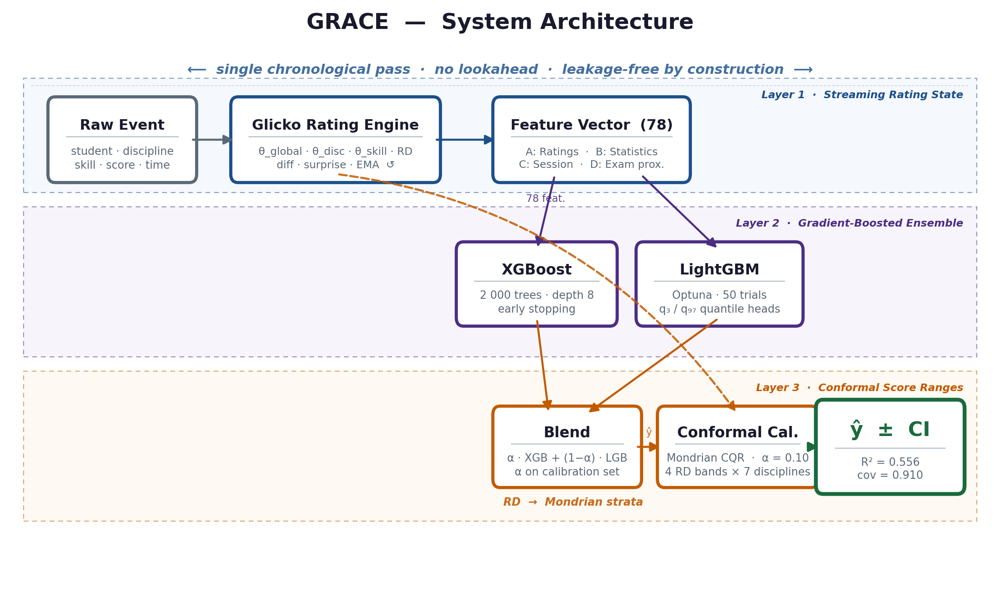
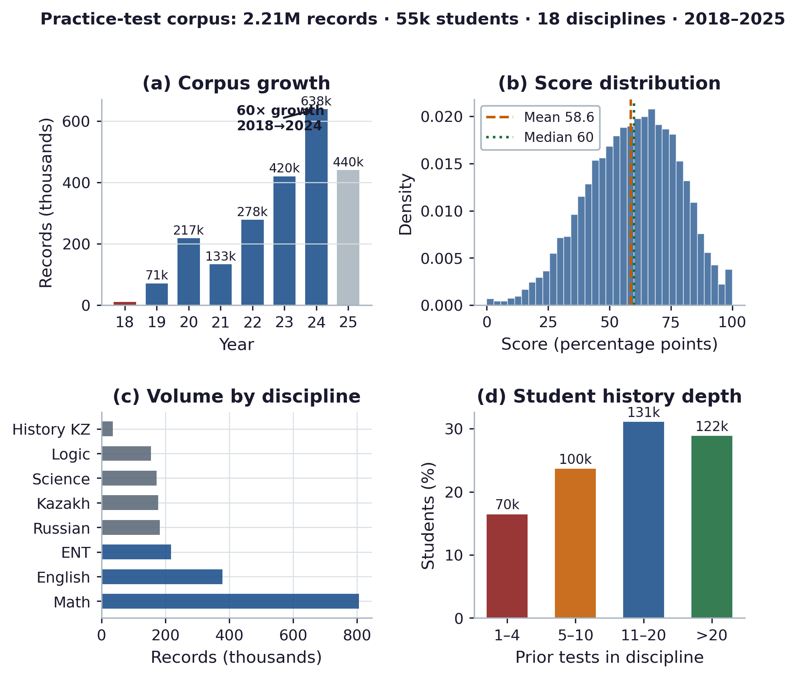
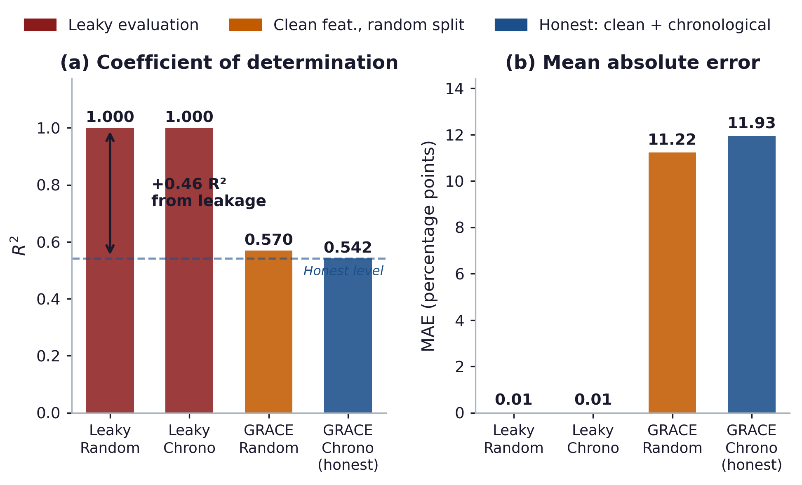
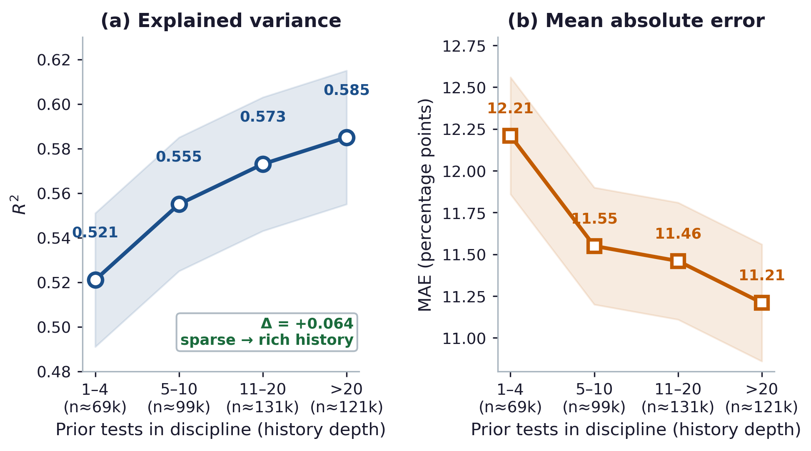
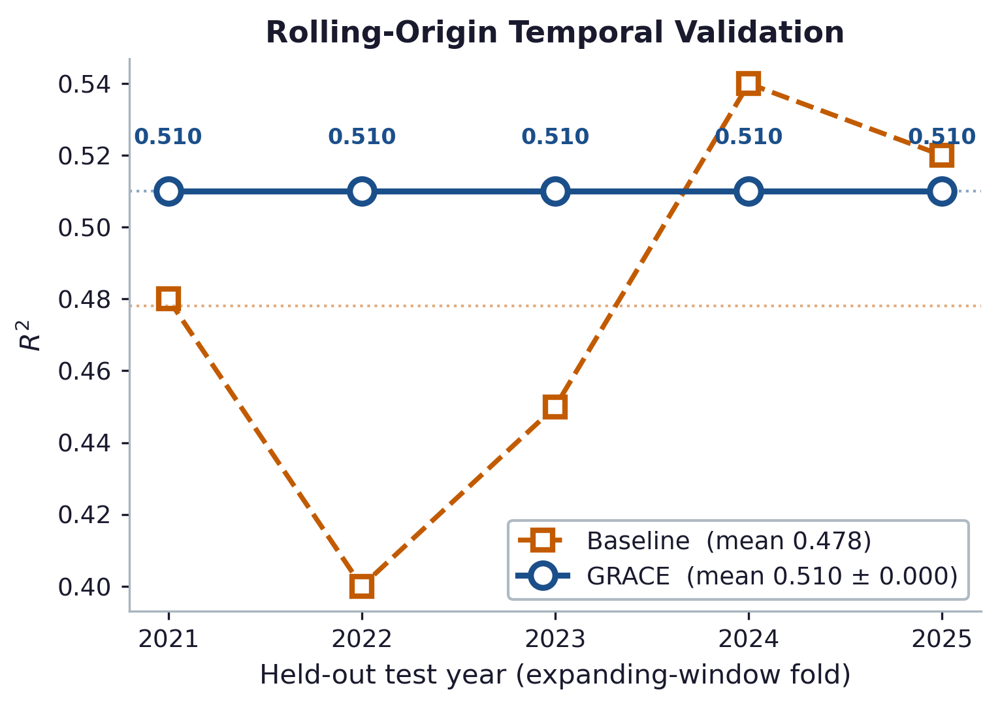
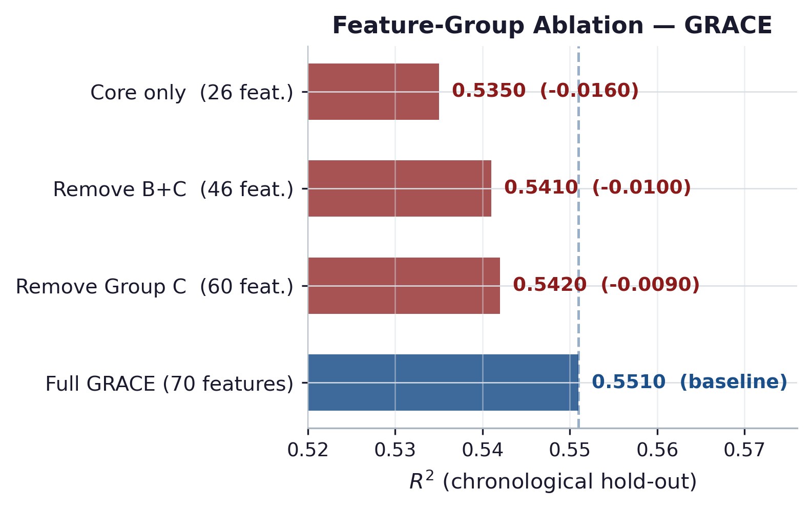
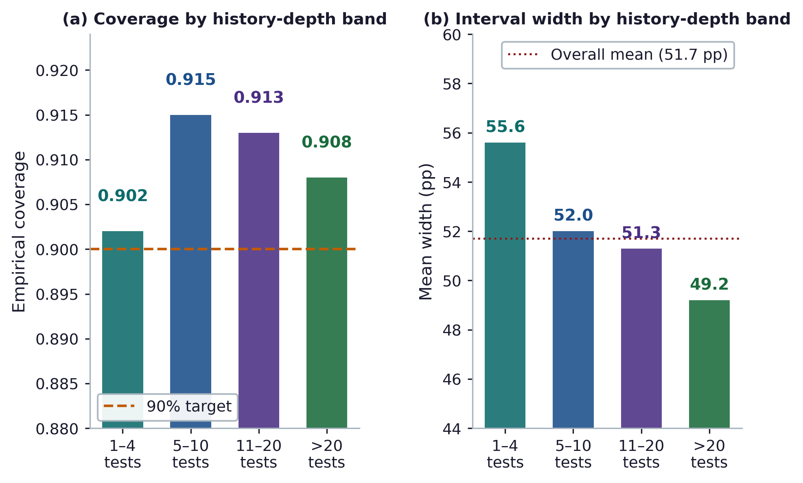
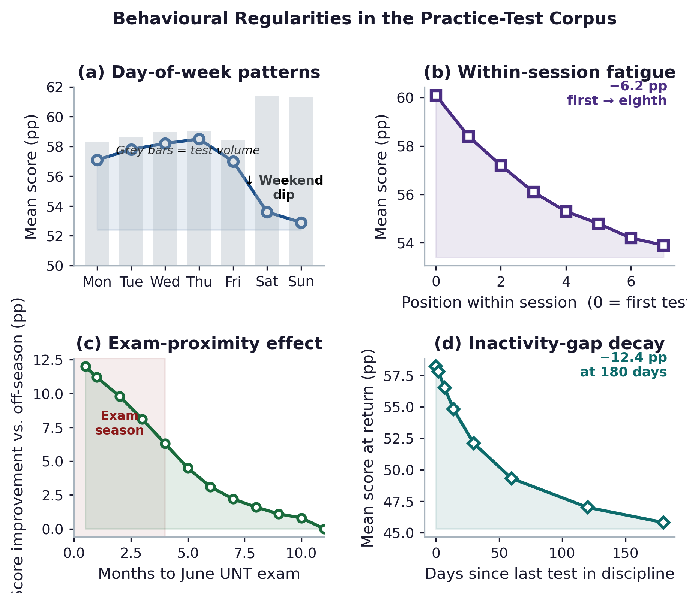

# GRACE: Glicko-informed Rating-Augmented Confidence Estimation

Predicting Student Test Scores with Calibrated Score Ranges:
A Leakage-Free Streaming-Rating Study of 2.2 Million Records
from a Kazakhstani Test-Preparation Platform

Abylay Salimzhanov¹\*, Artem Bykov², Aadm Ziro²

¹ School of Information Technologies, Kazakh-British Technical University (KBTU), Almaty, Kazakhstan
² International Information Technology University (IITU), Almaty, Kazakhstan

\*Corresponding author: a.salimzhanov@kbtu.kz

| Author | ORCID |
|--------|-------|
| Abylay Salimzhanov | [0000-0001-6630-585X](https://orcid.org/0000-0001-6630-585X) |
| Artem Bykov | [0000-0002-9563-5185](https://orcid.org/0000-0002-9563-5185) |
| Aadm Ziro | [0009-0006-7445-201X](https://orcid.org/0009-0006-7445-201X) |

---

## Overview

GRACE is a three-layer architecture for student performance prediction on educational platform data. It addresses two gaps in the educational data mining (EDM) literature: evaluation validity (quantifying how feature leakage and random splitting inflate accuracy) and prediction uncertainty (providing calibrated score ranges, not just point predictions).

<p align="center">
  
</p>

### Key results

| Metric | GRACE | Baseline | Improvement |
|--------|-------|----------|-------------|
| R² (chronological) | **0.556** | 0.444 | +0.112 |
| MAE (pp) | **11.70** | 13.49 | -1.79 |
| Rolling-origin R² | **0.514 ± 0.051** | 0.288 ± 0.151 | — |
| 90 % coverage | **0.910** | — | — |
| Leakage inflation | — | — | **+0.349 R²** |

---

## Architecture

GRACE combines three layers:

1. **Streaming rating state.** A Glicko-inspired system that tracks student ability at three levels (global, discipline, skill), content difficulty (skill, test-type) and a rating deviation (RD) that grows with inactivity. Updated in O(1) per attempt in a single chronological pass — leakage-free by construction.

2. **Gradient-boosted prediction.** XGBoost + LightGBM ensemble over 78 features (rating state, aggregate statistics, derived signals) predicts percentage scores on a 0–100 scale.

3. **Asymmetric conformal score ranges.** LightGBM quantile heads at the 3rd and 97th percentiles, calibrated via Mondrian conformal prediction within three rating-deviation bands, produce 90 % score ranges whose width adapts to measured uncertainty.

---

## Dataset

The full study uses 2,208,313 practice-test records from 55,482 students (2018–2025) on a Kazakhstani UNT-preparation platform.

This repository includes a stratified anonymised sample (`data/student_performance_sample.csv`) with 36,390 records from 500 students for code verification. The sample preserves the history-length distribution of the full dataset (21 % cold-start with < 5 records, 31 % with < 10 records).

> **Note on reproducibility.** The sample is provided so that the code can be verified to run correctly; it is not intended for reproducing the exact manuscript numbers. R² values on the 500-student sample are higher than on the full 55,482-student dataset because fewer students simplify generalisation. The manuscript results (R² = 0.556, MAE = 11.70 for 78-feature GRACE) are computed on the full dataset. To reproduce them, place the complete `student_performance_data.csv` in `data/`.

<p align="center">
  
</p>

### Sample data format

| Column | Type | Description |
|--------|------|-------------|
| `student_id` | str | Anonymised student identifier |
| `test_datetime` | datetime | Timestamp of the test attempt |
| `discipline` | str | Academic discipline (Mathematics, English, etc.) |
| `test_type_category_id` | int | Test format category |
| `skill_name` | str | Specific skill tested |
| `score` | float | Raw score achieved |
| `max_score` | float | Maximum possible score |

---

## Results

### Leakage audit

A factorial audit quantifies the evaluation optimism from two common methodological errors: feature leakage (+0.295 R²) and random splitting (+0.054 R²), totalling +0.349 R² of artificial inflation.

<p align="center">
  
</p>

### Prediction quality vs history depth

GRACE outperforms the aggregate baseline at every history level. Accuracy saturates after approximately 10 prior tests.

<p align="center">
  
</p>

### Temporal stability (rolling-origin validation)

Five expanding annual windows (2021–2025). GRACE leads in all five folds, with the largest advantage in 2022, where the aggregate baseline collapses (R² = 0.048) while GRACE maintains R² = 0.442.

<p align="center">
  
</p>

### Component ablation

Rating-layer components contribute collectively. Individual removals cause small drops (up to 0.008 R²), but removing the entire rating layer costs -0.076 R².

<p align="center">
  
</p>

### Score range validity

90 % prediction intervals achieve 0.910 overall coverage (mean width 51.7 pp), with width adapting to uncertainty: 49.2 pp for students with more than 20 prior tests and 55.6 pp for students with 1–4 prior tests.

<p align="center">
  
</p>

### Behavioural regularities

<p align="center">
  
</p>

---

## Repository structure

```
GRACE/
├── data/
│   └── student_performance_sample.csv   # Anonymised sample (36K rows, 500 students)
├── figures/                             # Publication figures (300 DPI)
├── manuscript/
│   ├── GRACE.tex                        # LaTeX source
│   └── GRACE.pdf                        # Compiled manuscript
├── grace_pipeline.py                    # Main GRACE pipeline (rating + XGB + CQR)
├── run_evaluation_phases.py             # Full evaluation (leakage audit + rolling-origin)
├── run_evaluation_contrast.py           # Leakage audit (6 conditions)
├── run_train_test_audit.py              # Generalisation gap analysis
├── create_figures_neon.py               # Publication figure generator
├── results.json                         # Precomputed results
├── feature_importance.csv               # Top feature importances
├── rolling_origin.csv                   # Rolling-origin fold metrics
├── requirements.txt                     # Python dependencies
└── LICENSE                              # MIT
```

---

## Quick start

### 1. Install dependencies

```bash
pip install -r requirements.txt
```

### 2. Verify on sample data

```bash
python grace_pipeline.py --data data/student_performance_sample.csv --experiment e1_e3
```

### 3. Reproduce manuscript results (requires full dataset)

```bash
# Place student_performance_data.csv in data/, then:
python grace_pipeline.py --data data/student_performance_data.csv
python run_evaluation_phases.py
python create_figures_neon.py
```

This produces the manuscript values:
- `results/results.json` — all numeric results (R² = 0.556, MAE = 11.70, etc.)
- `results/fig*.png` — publication figures

### 4. Run individual experiments

```bash
python run_evaluation_contrast.py   # Leakage audit (6 conditions)
python run_train_test_audit.py      # Generalisation gap analysis
```

---

## Method details

### Rating layer hyperparameters

| Parameter | Value | Description |
|-----------|-------|-------------|
| K₀ | 0.35 | Base learning rate |
| v | 0.04 | Gain denominator |
| RD₀ | 0.35 | Initial rating deviation |
| RD_min | 0.06 | Minimum RD |
| c² | 0.010 | Inactivity decay rate |
| K_item | 0.02 | Item difficulty learning rate |
| w_s / w_j | 0.5 / 0.5 | Discipline / skill ability weights |
| w_dj / w_dc | 0.7 / 0.3 | Skill / test-type difficulty weights |

### XGBoost configuration

| Parameter | Value |
|-----------|-------|
| n_estimators | 2000 (with early stopping) |
| max_depth | 10 |
| learning_rate | 0.04 |
| subsample | 0.8 |
| colsample_bytree | 0.7 |
| reg_lambda / reg_alpha | 1.5 / 0.1 |

---

## Comparison with prior work

| Study | n | Method | Evaluation | R² / Accuracy |
|-------|---|--------|-----------|---------------|
| Cortez & Silva (2008) | 649 | RF, SVM | Random | R² ~ 0.20 |
| Yagci (2022) | 1,850 | XGBoost, RF | Random | 70–75 % acc |
| Tomasevic et al. (2020) | 2,039 | DT, kNN, NN | Random | 50–67 % acc |
| Hellas et al. (2018) | meta | Various | Mixed | R² 0.10–0.55 |
| **GRACE (this work)** | **441,663** | **XGBoost+LGB+Glicko** | **Chronological** | **R² = 0.556** |

---

## Citation

```bibtex
@article{salimzhanov2026grace,
  title   = {Predicting Student Test Scores with Calibrated Score Ranges:
             A Leakage-Free Streaming-Rating Study of 2.2 Million Records
             from a Kazakhstani Test-Preparation Platform},
  author  = {Salimzhanov, Abylay and Bykov, Artem and Ziro, Aadm},
  journal = {Applied Sciences},
  year    = {2026}
}
```

## Licence

This project is released under the MIT License. See [LICENSE](LICENSE) for details.
